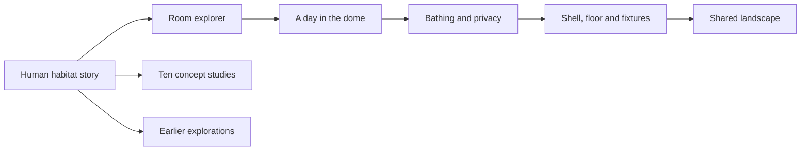

# The One-Room Dome

## A home that invites you to move

One generous room for sleeping close to the ground, working in several postures,
bathing in daylight, cooking, moving, and spending time together. A private
toilet enclosure brings a door where it matters; daily life shares the light.

[Explore the site](https://crs48.github.io/dome/) ·
[The ten studies](https://crs48.github.io/dome/studies/) ·
[Earlier explorations](https://crs48.github.io/dome/archive/)


*AI-generated design study, October 2026. A concept, not a photograph or building plan.*

## The primary story

The site follows the human habitat proposal through a continuous visual tour:

1. **The room** — explore sleeping, cooking, bathing, movement, work, and privacy.
2. **A day here** — choose a moment from waking to rest.
3. **Daylight bathing** — an open tub and curtained shower beside a private toilet.
4. **How it could work** — compare shell materials, floor systems, and attachments.
5. **Beyond the door** — connect a private home to gardens and shared spaces.

The selectors enhance server-rendered content. Without JavaScript, every story
remains readable. There is no autoplay, account, or saved interaction state.



## The archive

The original field guide, Blender design timeline, Grok Imagine art and fifteen
films, eight construction comparisons, before-building guide, resource directory,
and earlier colophon are preserved under `/archive/`. They have their own archive
navigation and a visible context banner.

The old `/design`, `/gallery`, `/methods`, `/before-you-build`, and `/resources`
URLs redirect into the archive. Browser redirects preserve query strings and
fragment links. `/about/` now explains the current collection and all image credits.

## Development

The site uses Astro 5, MDX, Tailwind CSS v4, and local responsive image processing.
It remains a static GitHub Pages project served under `/dome/`.

```sh
npm install
npm run dev       # development preview
npm run build     # Astro type checks and static build
npm run preview   # production preview
npm run posters   # regenerate legacy film posters; requires ffmpeg
```

Every push to `main` runs the existing GitHub Pages deployment workflow. Keep
hand-written internal links and public asset paths behind `withBase()` from
`src/lib/base.ts`; Astro prefixes imported image assets automatically.

## Project map

| Path | Purpose |
|---|---|
| `src/pages/index.astro` | Main human habitat narrative |
| `src/pages/studies.astro` | All ten concepts and their design notes |
| `src/pages/archive/` | Earlier pages and the archive index |
| `src/pages/[legacy].astro` | Compatibility redirects |
| `src/lib/concepts.ts` | Typed image collection and captions |
| `src/components/ConceptImage.astro` | Responsive AVIF/WebP images |
| `src/components/RoomExplorer.astro` | Activity selector and cutaway |
| `src/components/DayInDome.astro` | Day-cycle narrative |
| `src/components/MaterialStudy.astro` | Timber and mineral alternatives |
| `src/scripts/choices.ts` | Shared progressive enhancement |
| `src/styles/habitat.css` | Current editorial design |
| `src/assets/concepts/2026-10-human-habitat/` | Original PNGs and complete prompt provenance |
| `src/assets/photos/`, `src/assets/renders/`, `public/videos/` | Preserved earlier media |
| `design/` | Original Blender source models |

## Design and verification records

- [Illustrated proposal and lookbook](docs/explorations/0002_%5B_%5D_HUMAN_HABITAT_CONCEPTS_AND_WEBSITE_PROPOSAL.md)
- [Rebuild checklist and release record](docs/HABITAT-REBUILD.md)
- [Image prompts, revision provenance and checksums](src/assets/concepts/2026-10-human-habitat/manifest.json)
- [Earlier field-guide refresh](docs/REFRESH.md)

## Image provenance and licensing

The ten current studies were generated with OpenAI’s built-in image generation
tool. They are independent design variations, not coordinated views of one
measured model. The mineral shell and attachment details do not depict certified
manufacturer products. The archive retains the original Grok Imagine still and
films, alongside the author’s Blender studies.

**Code:** [MIT](LICENSE). **Media and prose:** [CC BY-NC 4.0](LICENSE-CONTENT).
An exploration by [Christopher Smothers](https://crs.land/).
