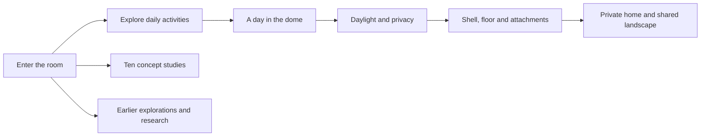

# Human habitat website rebuild

The primary site now follows the approved human-habitat proposal. The earlier field guide, design timeline, films, construction comparisons, and directory belong in an archive. Existing URLs should remain useful.

## Implementation

- [x] Review the approved proposal, existing routes, components, and generated assets.
- [x] Preserve earlier pages under `/archive` with a dedicated index and navigation.
- [x] Keep old page URLs working through redirects that preserve fragment links.
- [x] Add a typed concept collection with accurate captions and generator provenance.
- [x] Build the new image-led homepage, room explorer, and day selector.
- [x] Add the complete concept collection and update the colophon.
- [x] Update navigation, responsive styling, metadata, and README.

## Verification and release

- [x] Run Astro checking and the production build.
- [x] Audit generated internal links, image references, headings, and redirects.
- [x] Check desktop and mobile layouts, room/day controls, keyboard use, and archive navigation.
- [x] Check the no-JavaScript presentation and reduced-motion behavior.
- [x] Verify responsive image output and opening-page asset sizes.
- [x] Commit the completed rebuild and publish through the existing GitHub Pages workflow.
- [x] Confirm the live deployment and record its URL and revision.

## Verification evidence

- Astro check: 0 errors, warnings, or hints; production build generated 16 HTML routes.
- Static audit: 852 local link, fragment, and asset references resolved; one H1 per page, no duplicate IDs, all images have alternate text.
- The homepage has one eager image and lazy loading for subsequent studies. It contains no video requests. All concept images have explicit dimensions and responsive AVIF/WebP sources.
- Desktop at 1440px and mobile at 390px: homepage, room explorer, day selector, material alternative, archive index, and study collection reviewed. No horizontal document overflow.
- Keyboard Enter selects the private-toilet description; pointer selection switches the work/rest scenes and timber/mineral alternatives.
- Legacy `/methods/?from=legacy#bioceramic-geoship` resolves to the archive with query and fragment preserved and the target present.
- A script-free response of the production HTML exposes all 14 room/day/material stories and hides inactive controls. No account, network request, or saved preference is used by the selectors.
- Reduced-motion CSS removes smooth scrolling and transitions; selectors do not animate or auto-advance.
- Original artwork, fifteen films, Blender models, and archived research remain available.

### Asset sizes and captures

The built homepage HTML is 41,716 bytes (8,740 bytes with gzip), with a 40,468-byte stylesheet. The hero offers four widths: AVIF source files range from 44,263 to 272,659 bytes and WebP from 28,598 to 189,912 bytes. These are file sizes, not a measured network waterfall; browser caching, pixel density, font loading, and nearby lazy images affect transfer. Original PNGs download only when a visitor chooses a full-size study.

The sitemap contains 11 canonical pages; the five redirect-only legacy routes are excluded.

- [Desktop opening](previews/habitat-desktop.jpg)
- [Mobile opening](previews/habitat-mobile.jpg)
- [Interactive room explorer](previews/habitat-room-explorer.jpg)

## Published release

[The rebuilt site](https://crs48.github.io/dome/) is live. [GitHub Pages run 38059508349](https://github.com/crs48/dome/actions/runs/38059508349) successfully built and deployed application revision `e3477e8513e76b17d0e4a65db304dd8cbe4f3b7a`.

The live homepage, study collection, archive index, original gallery, and legacy design redirect returned HTTP 200 with the expected content. The live room explorer was also exercised in the browser, including private-toilet selection.

This final release record changes documentation only; the deployed application is the verified revision above.
