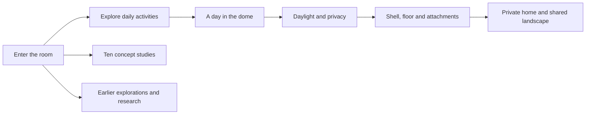

# Human habitat website rebuild

The primary site now follows the approved human-habitat proposal. The earlier field guide, design timeline, films, construction comparisons, and directory belong in an archive. Existing URLs should remain useful.

## Implementation

- [x] Review the approved proposal, existing routes, components, and generated assets.
- [x] Preserve earlier pages under `/archive` with a dedicated index and navigation.
- [x] Keep old page URLs working through redirects that preserve fragment links.
- [x] Add a typed concept collection with accurate captions and generator provenance.
- [x] Build the new image-led homepage, room explorer, and day selector.
- [x] Add the complete concept collection and update the colophon.
- [x] Update navigation, responsive styling, metadata, and README.

## Verification and release

- [ ] Run Astro checking and the production build.
- [ ] Audit generated internal links, image references, headings, and redirects.
- [ ] Check desktop and mobile layouts, room/day controls, keyboard use, and archive navigation.
- [ ] Check the no-JavaScript presentation and reduced-motion behavior.
- [ ] Verify responsive image output and opening-page transfer size.
- [ ] Commit the completed rebuild and publish through the existing GitHub Pages workflow.
- [ ] Confirm the live deployment and record its URL and revision.
