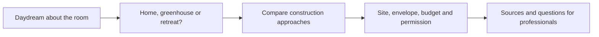

# A less rectangular field guide

## Editorial and experience audit

The existing project has valuable original Blender studies, clearly labeled AI concept films, eight material comparisons and a substantial directory. Preserve those assets and routes. The refresh gives curious newcomers an inviting path from daydream to practical questions.

- [x] Inspect the current published code and preserve the older local branch in a separate worktree.
- [x] Review primary building-science, code-evaluation and vendor documentation.
- [x] Add a warmer illustrated visual system and useful purpose chooser.
- [x] Replace unsupported cost, insulation, lifespan and disaster-proof comparisons.
- [x] Expand the design tradeoffs and add a practical before-building guide.
- [x] Check type safety, static routes, desktop/mobile layout and interactions.
- [x] Publish and verify the live Pages deployment.

## Evidence corrections

The old comparison mixed kit, shell and finished-house prices and gave unsourced R-values and century-long lifespans. It also generalized FEMA safe-room protection to monolithic domes, described all earthbags as ICC-ES listed, called materials fireproof, and implied paneled domes necessarily lack drainage planes. Replace these with assembly-specific questions and scoped claims. Geometry alone does not establish a building's performance.

Primary references reviewed on 2026-10-10:

- [DOE passive solar design guide](https://www.energy.gov/sites/default/files/2021-08/ES-Passive%20Solar%20design_081321.pdf): glazing, heat storage and solar control must work together.
- [FEMA P-320](https://www.fema.gov/sites/default/files/documents/building-safe-room-home-small-business.pdf): safe rooms require specific design criteria; FEMA does not certify products or builders.
- [ICC alternative-product evaluation](https://www.iccsafe.org/building-safety-journal/bsj-technical/construction-referees-evaluation-processes-for-alternative-building-products-2/): evaluation reports support the building official's review, with conditions of use.
- [CalEarth builder resources](https://calearth.org/pages/resources-for-builders): its report addresses a particular cement-stabilized earthbag system, with specified conditions and professional drawings.
- [Natural Spaces pricing catalogue](https://naturalspacesdomes.com/dome-system/pricing-and-planning/): shell, framing, foundations and interior finishing are separate scopes.

Vendor links describe systems and are not independent validation or endorsements. The old directory's “verified” badges referred to link checks, not technical verification; remove that ambiguous quality signal. Existing license terms and image provenance remain intact.

## Verification

- `npm run build`: 0 Astro errors, warnings or hints; all 7 static routes built.
- Generated-HTML audit: 216 internal links/assets/anchors checked, one H1 per page and no duplicate IDs.
- Desktop and 390px browser review: homepage, comparison table and long guide remain readable; no horizontal page overflow.
- All three purpose choices work; keyboard Enter activates the selected note. Native claim disclosures expand. All notes remain in the initial HTML for no-JavaScript reading.
- The featured film requires an explicit play action, respecting visitors who prefer less motion and avoiding automatic video downloads.
- Original six routes, 15 concept films, source Blender assets and original licensing retained. Added self-hosted font license notices.
- Existing Astro 5 toolchain has npm advisories; this static-content refresh does not enable a runtime server or process visitor inputs. A framework major-version migration is separate work.

Release verified: [GitHub Pages run 38048309028](https://github.com/crs48/dome/actions/runs/38048309028) succeeded for `a64434b`; the live homepage and new guide were confirmed. An independent read-only review found no actionable regressions in the changed routes, assets, interaction logic or research claims.
