# Human habitat dome concepts and website proposal

Prepared for Christopher Smothers · October 10, 2026

## The pitch

**A home that invites you to move.** One generous room for sleeping close to the ground, working in several postures, bathing in daylight, cooking, stretching, and spending time together. A private toilet provides a door where it matters. The rest of the home can share the light.

The dome becomes a habitat for an active body: an insulated shelter, a useful concrete floor, and an adaptable family of things attached around the perimeter. Its most valuable feature is the space left available. Outside, a private planted court opens toward food gardens and shared gathering places.

The strongest next version of the website would let someone imagine **a whole day in this room**, then explore how the shell, services, and privacy choices could support that life. Lead with the lived experience and keep the existing construction research close at hand.

## 🎨 Ten visual studies

All ten images were generated with the built-in image generation tool for this exploration. They are independent design variations, not coordinated views of one measured model. The approximate 9 m scale used in several prompts is an exploratory assumption, not a settled footprint. Exact 5/8-sphere geometry, clearances, structure, and construction assemblies require a subsequent drawn model.

Original PNGs and the complete prompt set are in [the asset folder](../../src/assets/concepts/2026-10-human-habitat/). [The manifest](../../src/assets/concepts/2026-10-human-habitat/manifest.json) records prompts, the cutaway revision, dimensions, and checksums.

### 01 A habitat for an active body

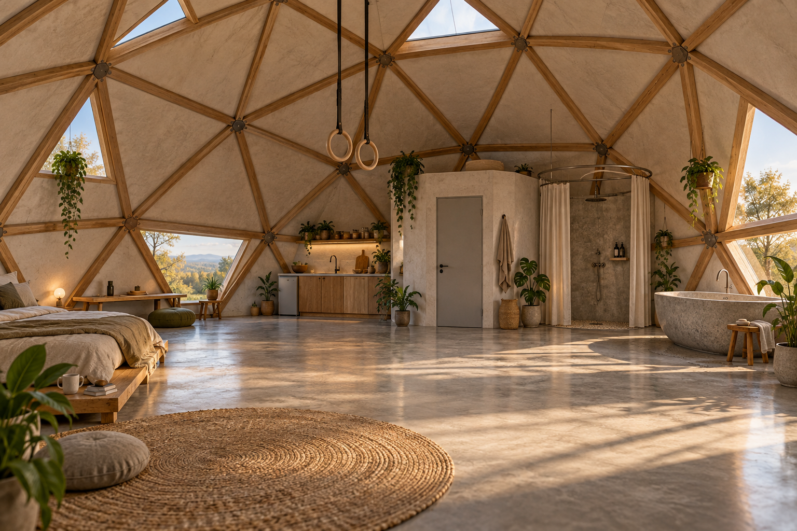

**The lead image.** Timber makes the structure legible. The kitchen and bathing functions occupy one edge; the center stays available. The low bed and work surface offer a starting point for a room with very little furniture.

Carry forward the open center and compact service grouping. A measured next pass should place the rings over a padded movement zone with clear travel paths around it, and include a ventilated cooking area.

### 02 Bathing in the light

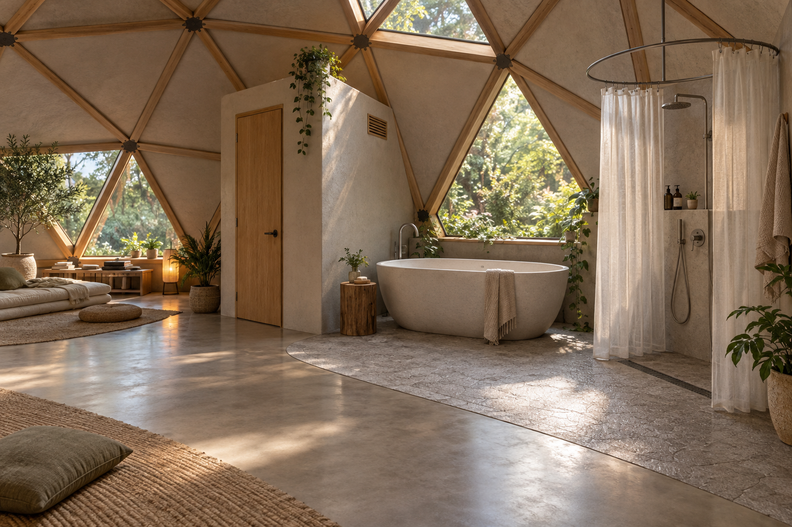

**The most distinctive spatial idea.** The toilet has an opaque enclosure; the bath and shower enjoy daylight. A curtain gives the shower an adjustable boundary. The material transition makes the wet area readable without turning it into another room.

Keep the wet floor slip resistant, drained, and waterproofed. The polished concrete belongs in the dry living area. The visible grille is only a visual placeholder: toilet and bathing extraction need outdoor discharge, and a curtain controls sightlines and some splash, not humidity. Include a handwashing basin in the measured service plan.

### 03 One room, many daily lives

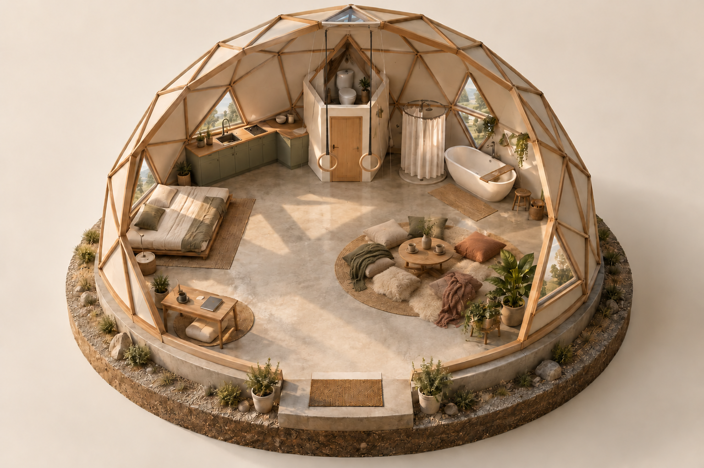

**The orientation image.** This is the best base for a website room explorer. Hotspots could explain sleep, work, movement, cooking, bathing, and the private toilet. The toilet enclosure is cut open at the top to reveal its contents in this model; the proposed real enclosure would have a ceiling.

The initial image produced oversized hoops; the saved revision replaces them with gymnastic rings. This illustrates why the AI studies need a geometry and clearance pass before they become floor plans. Replace the illustrated entry step with a resolved level threshold in that pass.

### 04 A mineral shell in a living landscape

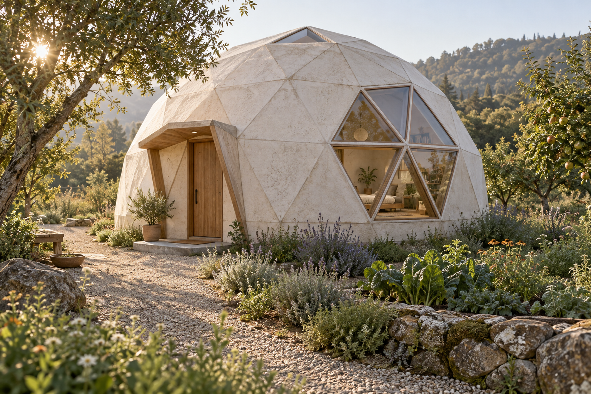

**The exterior direction.** Opaque mineral facets, selected windows, and a sheltered entrance make the dome read as a home. The surrounding garden can provide privacy, seasonal shade, and food-growing space.

This is an original bioceramic-inspired appearance, not a rendering of a Geoship product. Resolve the illustrated doorstep, roof drainage, window flashing, and planting clearances in a site-specific design.

### 05 Quiet mineral interior

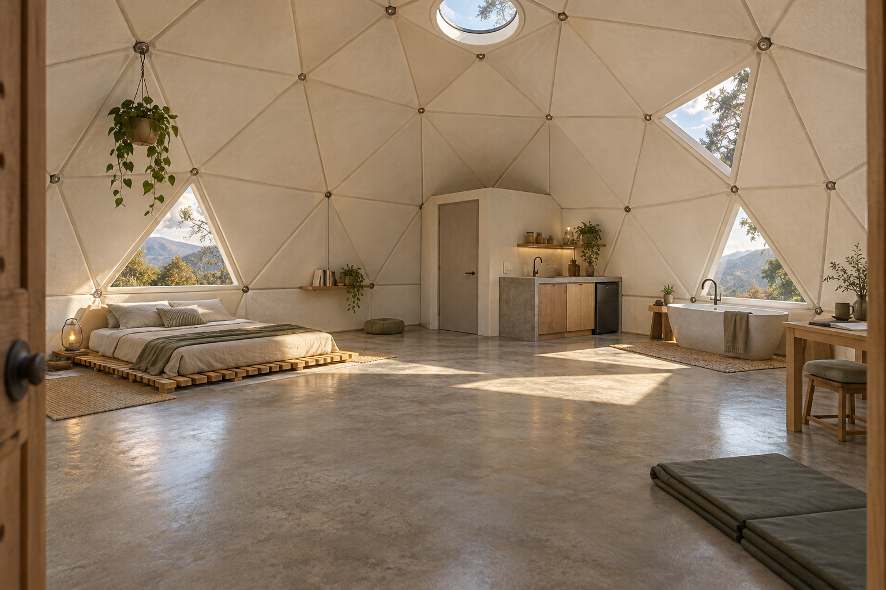

**The quieter material alternative.** Pale facets reflect daylight into the volume; small fittings suggest an attachment system integrated with the structure. A few timber elements keep the room tactile.

Use this to compare atmosphere with study 01. The image does not establish a ceramic material recipe, insulation value, or a viable embedded anchor. The small kitchen and desk are placeholders whose usable dimensions need testing.

### 06 An attachment language

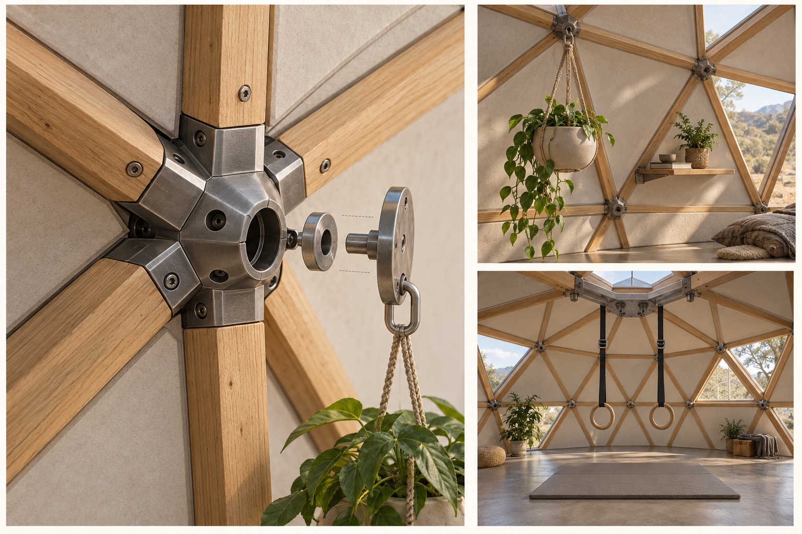

**A useful product idea inside the architectural idea.** A repeatable interface could make it easy to attach lamps, shelves, curtains, and planters without repeatedly damaging finishes.

Develop distinct accessory and human-suspension interfaces. The visualized mechanism is invented and unrated; its fasteners and proportions are not a fabrication detail. Rings and silks introduce dynamic loading and need a designed load path through the frame to its foundations. A strong-looking vertex alone does not establish that capacity.

### 07 The floor as infrastructure

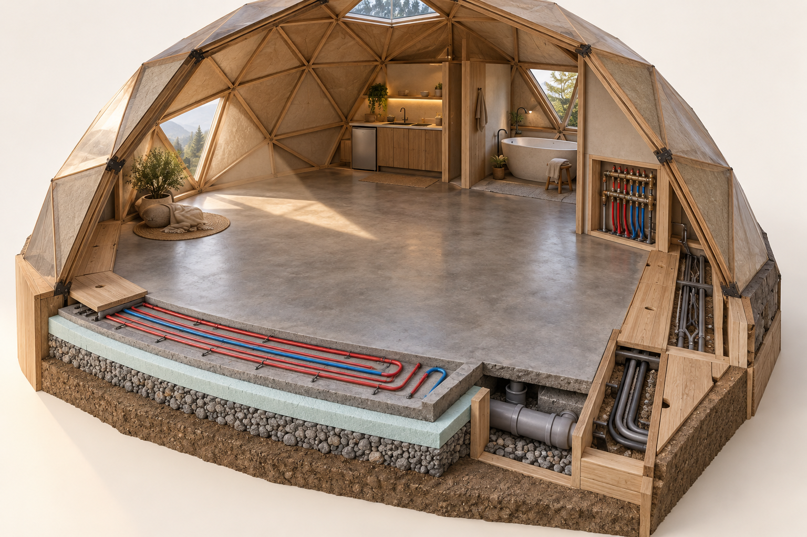

**The practical backbone.** Let the slab provide the durable surface and thermal mass, while a perimeter service route keeps valves, wiring connections, and controls accessible. Place the kitchen, toilet, and bath near that route.

The section is a visual explanation only. Pipe layout, structural reinforcement, membrane continuity, slab edges, separation of services, and drain slopes are unresolved; some are omitted in the image. Heating and cooling water form a closed hydronic system separate from drinking water and wastewater. Avoid making every future repair require cutting the slab.

### 08 One surface, several postures

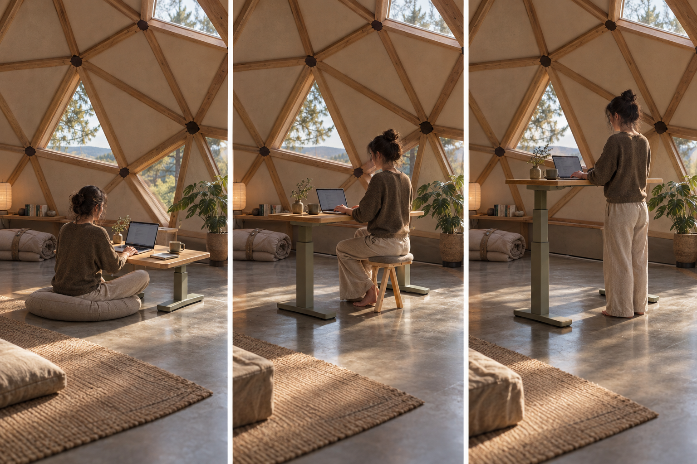

**Make posture changes easy.** The same work surface could also support meals, drawing, or conversation. Keep power around the edge so the movement floor stays clear.

The telescoping mechanism is illustrative. Prototype the unusually large height range, stability, knee clearance, pinch protection, and monitor setup before treating it as a product. A low table plus a separate standing shelf is a simpler alternative worth comparing. Retain a supported seat for days when the floor is less inviting.

### 09 The room becomes a refuge

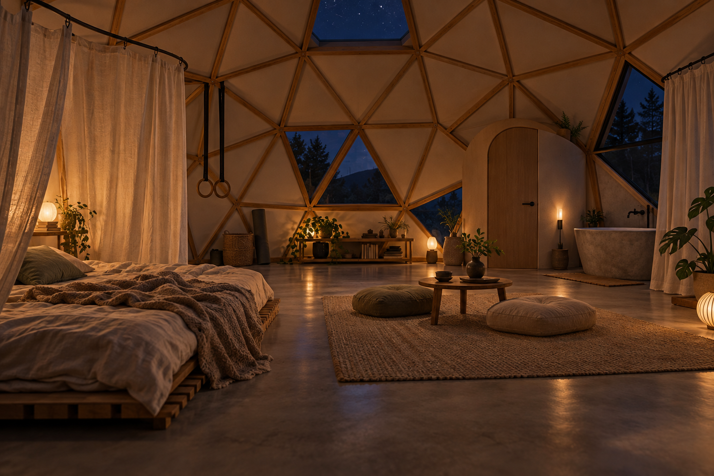

**Openness can change over the day.** Curtains soften the sleeping area, lamps bring the room down to human scale, and the center becomes a place to gather. A ventilated low bed base and bedding storage make floor sleeping easier to maintain.

Curtains provide visual privacy, with limited sound separation. The next study should test sleeping while someone else cooks or works, acoustic treatment, glare, and external window privacy. Equipment storage must clear circulation and sleeping space.

### 10 A private home, a shared world

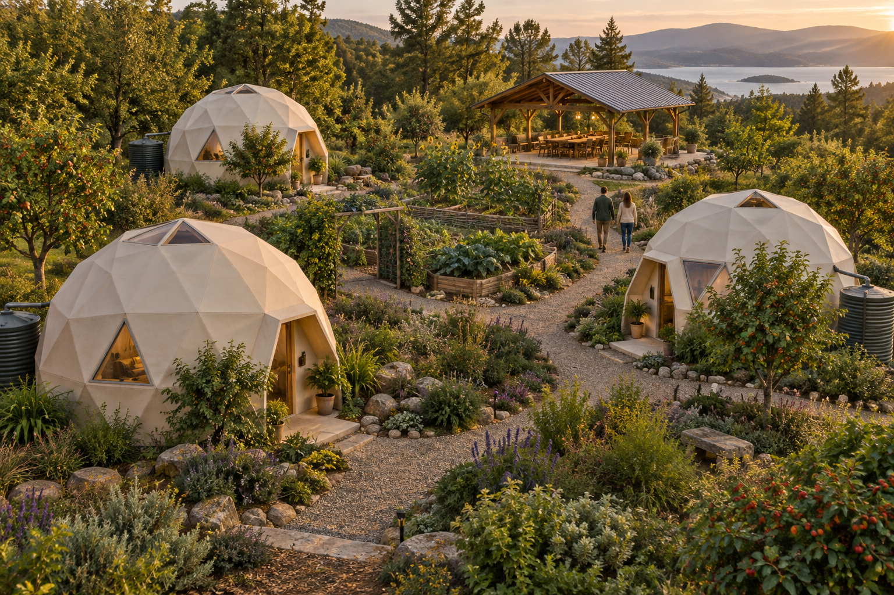

**The private room belongs to a larger pattern.** A personal home can support most daily needs while larger gatherings, tools, and other activities have shared places nearby.

The village image is a relationship study. Siting, planted privacy, accessible routes, fire access, utilities, water collection, maintenance, and land governance need separate work. The cisterns illustrate an intention; the image does not resolve dome gutters or prove water self-sufficiency.

## What the existing website already does well

The repository is an Astro static site with seven routes, an original AI still, fifteen concept films, Blender studies, eight construction comparisons, and a before-building guide. Its warm paper, moss, and clay palette already fits this direction.

| Existing piece | Opportunity |
|---|---|
| `src/pages/index.astro` | Give the body-centered dwelling concept the opening story; use study 01 prominently. |
| `src/pages/design.mdx` | Expand the Blender timeline into a daily-life tour with explicit open bathing and private toilet choices. |
| `src/pages/gallery.astro` and `src/components/Gallery.astro` | Add themed studies and useful captions so visitors can compare ideas. |
| `src/lib/media.ts` | Add a separate concept manifest with per-asset provenance. Its existing stills are described as Grok Imagine; the new work needs its own credit. |
| `src/pages/methods.astro` and `src/content/methods.yaml` | Connect materials to actual shell assemblies and the two visual directions. |
| `src/pages/before-you-build.mdx` | Extend with the wet-zone, service-access, condensation, and suspension questions specific to this concept. |

The wording “pleasantly impractical dream” currently makes the idea sound less serious than the design intent. Replace that opening with a direct invitation and place technical questions beside the features they explain.

## Context from your other projects

[crs.land](https://crs.land/) connects this home to [Floor Life](https://crs48.github.io/floor-life/), [Food Forests](https://crs48.github.io/food-forests/), [deadbutt.fyi](https://deadbutt.fyi/), and community-oriented experiments. The common theme I take from those sites is giving people more ways to inhabit their bodies and surroundings, with curiosity and useful evidence.

Carry that voice into the dome site. Floor living should offer variety, support, and choice. Describe the room as inviting movement; avoid promising to cure gluteal amnesia or presenting furniture removal as treatment. Let the garden story include tending and shared responsibilities alongside abundance.

## Design findings and alternatives

### A service crescent leaves the center available

| Layout option | What it makes possible | Tradeoff |
|---|---|---|
| **Perimeter service crescent — recommended starting point** | Kitchen, closed toilet, basin, shower, and tub share an edge; the center stays open. | Cooking and bathing need separate ventilation and careful adjacency. |
| Compact freestanding service core | Plumbing concentrates in a small volume; its back can screen sleep or work. | A central object interrupts the open room and movement routes. |
| Bathing along a private garden edge | Strong connection to daylight, plants, and outdoor privacy. | Services may spread out; glazing and night privacy become more demanding. |

Combine the first and third: a compact service crescent whose bathing end faces the private garden. Put the toilet door away from the kitchen work surface. Allow the pod to screen bedding storage or the work corner without becoming a hallway. The visual studies explore these relationships rather than a final orientation.

### The concrete floor can store heat and remain serviceable

Sunlight absorbed by an exposed floor becomes stored heat. Insulation, aperture placement, and seasonal shading determine whether that heat is useful. The passive-solar strategy is to admit useful winter sun and limit unwanted summer gains; thermal mass by itself is not a source of cooling. [DOE passive solar design guide](https://www.energy.gov/sites/default/files/2021-08/ES-Passive%20Solar%20design_081321.pdf)

For this concept, propose embedded hydronic loops, an accessible manifold, and serviceable perimeter routes for changeable connections. Evaluate under-slab and edge insulation together with moisture and ground conditions. Preserve sufficient exposed slab for the intended thermal behavior while providing removable cushions, rugs, and exercise mats where bodies need them.

Radiant cooling removes sensible heat but does not dehumidify the room. It needs dew-point-based control and complementary humidity management. An open shower makes that coordination especially consequential. Keep the floor surface above the indoor dew point; determine capacity with a climate-specific load model. [Uponor radiant heating and cooling FAQ](https://www.uponor.com/en-us/customer-support/faq)

The design should therefore compare **radiant heating with separate cooling/dehumidification** against **reversible radiant heating and cooling with coordinated humidity controls**. Summer shading and suitable night ventilation can contribute where local conditions permit; mechanical heat removal may still be necessary.

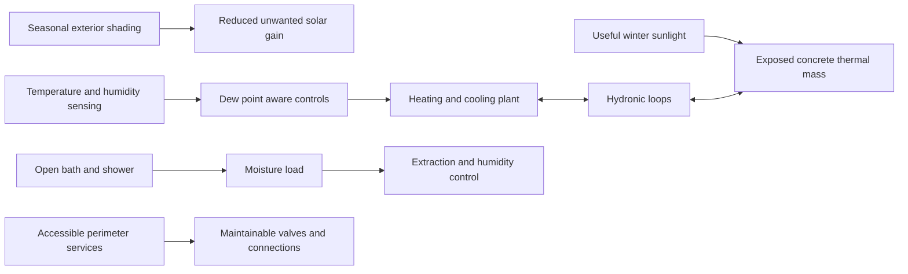

### Shell choices should describe assemblies

The bioceramic company referenced in the brief appears to be **Geoship**. Its construction account describes panels bonded to a frame and a loft connected through purpose-designed hub details. That is useful precedent for integrating fixtures with structure; it does not establish that arbitrary vertices can support aerial exercise. These images are independent concepts, with no implied manufacturer endorsement. [Geoship construction account](https://geoship.is/blog/geojourney-episode-9)

| Direction to explore | Design appeal | Questions that determine viability |
|---|---|---|
| Timber frame with insulated panels and mineral interior finish | Readable structure, warm touch, opportunities for repairable components | Complete weather layer, airtightness, insulation continuity, fire design, and hub engineering |
| Bioceramic system | Mineral surfaces and integrated shell language | Actual supplied assembly, supporting test reports, service interfaces, attachment permissions, repair process, and local approval |
| Metal frame with insulated panels | Precise repeatable connections and modular possibilities | Thermal bridges, corrosion, condensation, acoustic behavior, and glazing details |
| Limited translucent or glazed triangles within an insulated shell | Daylight placed where the body uses it | Seasonal gains, glare, privacy, cleaning, seals, and replacement access |

These are study directions, not rankings of cost, insulation, embodied carbon, or strength. Compare complete assemblies and site requirements before selecting one. [Natural Spaces' hub system](https://naturalspacesdomes.com/dome-system/) offers another example of purpose-designed geodesic connections, rather than a general license to hang from any node.

### An adaptable room still needs useful support

Add a stable perch and hand support for floor transfers. Keep the entrance level, store shoes and wet clothing near it, and leave a route through the room even when bedding is open. Offer a small handwashing basin beside the toilet, towel drying near extraction, reachable storage, and a place for cleaning equipment. Decide whether laundry belongs in the service crescent or a nearby shared space.

An acoustic layer could live on selected dry facets and in removable textiles. Put task lighting at work and cooking surfaces, soft lighting near the floor, and adjustable screening at the bed and windows. Use separate spill trays and accessible watering for planters. These small provisions make the room easier to live in without filling the center.

For regeneration, carry the idea beyond the image: compare concrete mixes and material quantities, design for repair, choose locally suitable planting, and plan who tends shared spaces. Treat carbon, energy, water, and habitat benefits as things to assess.

## Proposed website experience

### Opening copy

> **A home that invites you to move.**
>
> Sleep close to the ground. Work at a height that suits you. Bathe in the daylight. Keep room for stretching, cooking, and being together.
>
> An exploration of one private, adaptable space beneath a geodesic shell—with a living landscape and shared places beyond it.

Primary action: **Explore the room**. Secondary action: **See how it could work**.

### Six additions worth making

1. **A day in the dome.** Use a handful of deliberate scenes and selectable chapters: wake, work, move, bathe, gather, rest. Start with stills and accessible buttons. The current studies establish moods; matching transitions should eventually come from one consistent Blender model.
2. **An annotated room cutaway.** Make the six daily functions selectable on study 03, with equivalent text links below the image for mobile, keyboard, and no-JavaScript use. Each description answers what the feature gives you and what remains to resolve.
3. **A bathing and privacy study.** Show the private toilet, daylight tub, and shower curtain together. Compare open and screened bathing without implying the whole bathroom must become a separate room.
4. **A shell and materials studio.** Compare the timber and mineral images side by side, then offer an assembly comparison linked to the existing methods guide. Keep vendor claims visibly attributed.
5. **A floor and fixtures explainer.** Use studies 06–08 to connect concrete, accessible services, fixture attachment, and changes in work posture. Label the hardware and desk mechanism as concepts.
6. **A home within a commons.** End with the garden and pavilion scene, linking to Floor Life, Food Forests, and the community experiments. Explain which needs the private room supports and which become shared choices.

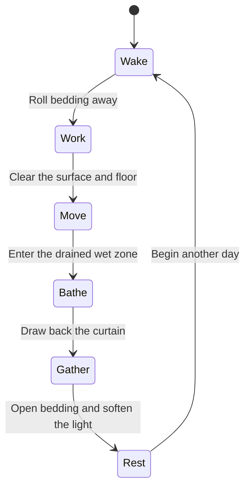

This sequence is an interaction idea, not a required lifestyle. Visitors should be able to choose any activity directly. Keep automatic animation off and respect reduced-motion preferences.

### Implementation approach

Use the existing Astro site and optimized image pipeline. A small declarative concept collection can drive gallery cards, chapter navigation, and material groupings without duplicating captions. Preserve the current routes and research. First add a concept-study section in `/gallery` and an expanded `/design` story; adjust the homepage once those destinations exist.

For example, a future `src/lib/concepts.ts` could contain:

```ts
import bathing from '../assets/concepts/2026-10-human-habitat/02-daylight-bathing.png';

export const concepts = [
  {
    id: 'daylight-bathing',
    image: bathing,
    theme: 'bathe',
    title: 'Bathing in the light',
    alt: 'Open tub and curtained shower beside an enclosed toilet pod',
    caption: 'Share the daylight; make privacy adjustable.',
    provenance: 'AI concept · built-in image generation · October 2026',
    status: 'Design study',
  },
] as const;

export const conceptsFor = (theme: typeof concepts[number]['theme']) =>
  concepts.filter((concept) => concept.theme === theme);
```

Render with Astro `Picture` or `Image`, responsive sizes, explicit dimensions, and lazy loading below the opening image. The ten original PNGs total roughly 28 MB; keep those as source assets and deliver appropriately sized AVIF/WebP images. Retain the existing Grok and Blender attribution alongside the new generator credit.

## Recommendation and next experiments

Use **study 01 as the visual lead, study 02 as the distinctive feature, and study 03 as the navigation model**. Keep the mineral shell as a serious alternative. Together they explain the home quickly while opening several useful design questions.

Before generating another large set, build one measured layout and test it at full scale with tape, a mattress, a low table, and a mock toilet enclosure. Walk through cooking while someone works, bathing while someone rests, and having two guests over. Confirm the amount of clear floor, bed ventilation, private sightlines, and routes when everything is in use.

The next visual pass should then focus on three coordinated layouts, adjustable window privacy, the sleeping-area storage, a resolved handwashing station, a small laundry option, and an acoustically treated interior. Establish site climate and a target usable area before making thermal or cost comparisons.

## Implementation checklist

- [x] Inspect the existing site, media pipeline, and prior exploration.
- [x] Review crs.land and the related floor, movement, and garden projects.
- [x] Generate ten concepts and correct the oversized cutaway rings.
- [x] Save every selected original, complete prompts, and provenance in the repository.
- [x] Write the visual lookbook, spatial alternatives, research, and website pitch.
- [ ] Choose a lead visual direction and a target footprint for the measured study.
- [ ] Build one consistent Blender model and test the layout with a physical mockup.
- [ ] Add the concept collection and expanded design/gallery experiences to Astro.
- [ ] Revise homepage storytelling and generator attribution across the affected pages.
- [ ] Add the room explorer and day-cycle controls after the static story is readable.

## Validation checklist

- [x] Inspect all ten generated outputs for the intended visual topic and material direction.
- [x] Confirm ten 1536 × 1024 PNGs and preserve their checksums.
- [x] Label independent visual studies, conceptual mechanisms, and unresolved geometry.
- [x] Distinguish thermal storage, heat removal, and humidity control.
- [x] Retain private toilet intent while keeping bath and shower daylit.
- [x] Verify all 22 local image and document references across the proposal and README.
- [ ] For implementation: build the site and check responsive image output and asset weights.
- [ ] For implementation: check desktop/mobile layout, keyboard access, no-JavaScript reading, and reduced motion.
- [ ] For the building design: review loads, wet detailing, ventilation, energy, circulation, and local requirements with the relevant designers.

## References

Personal context: [crs.land](https://crs.land/), [Floor Life](https://crs48.github.io/floor-life/), [Food Forests](https://crs48.github.io/food-forests/), and [deadbutt.fyi](https://deadbutt.fyi/). These inform voice and intent rather than establish building performance.

Technical context: [DOE passive solar home design](https://www.energy.gov/sites/default/files/2021-08/ES-Passive%20Solar%20design_081321.pdf), [Uponor radiant heating and cooling FAQ](https://www.uponor.com/en-us/customer-support/faq), [Geoship construction account](https://geoship.is/blog/geojourney-episode-9), and [Natural Spaces dome connection system](https://naturalspacesdomes.com/dome-system/). Manufacturer sources describe their own systems; this proposal does not verify product certification or performance.

Repository context: [previous refresh record](../REFRESH.md), [README](../../README.md), and [new image provenance and prompt manifest](../../src/assets/concepts/2026-10-human-habitat/manifest.json).
